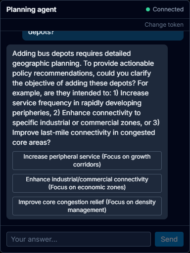
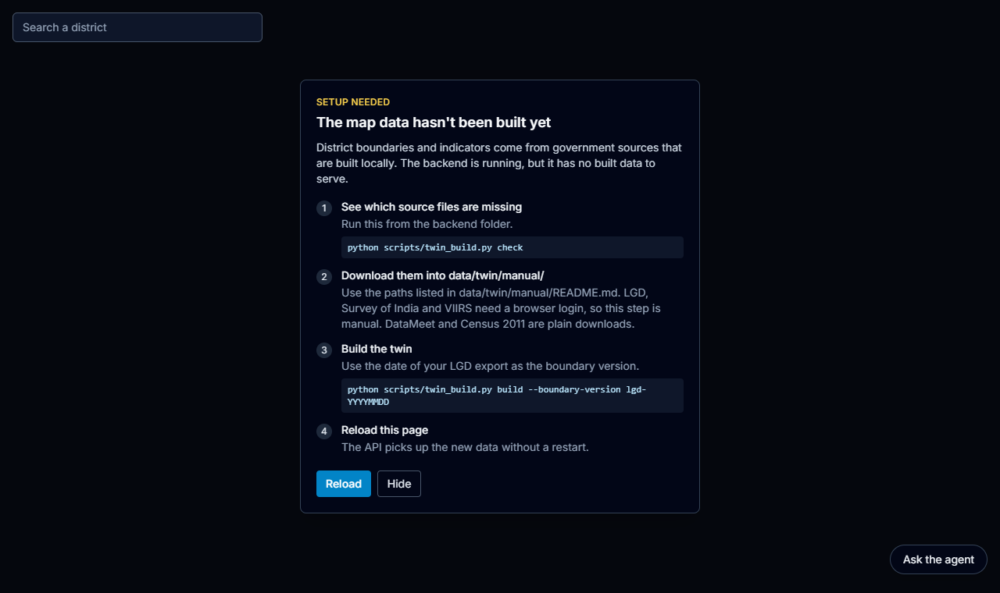

# MetroPulse

### An India district digital twin with a tool-using planning agent

MetroPulse is a FastAPI + Next.js app. It has two parts that work today:

1. **India Twin.** District boundaries keyed to official LGD codes. It answers place-name lookups
   and serves district indicators from Census 2011 and VIIRS night lights. Every value comes with a
   provenance receipt (source, licence, dataset version, period) and a trust label.
2. **Planning agent.** A ReAct-style agent you chat with over a token-gated WebSocket (`/ws/agent`).
   It streams its reasoning steps, tool calls and clarifying questions to a chat panel on the map.

It produces data-informed estimates for exploration. It does not forecast city outcomes, and its
answers are not decision-grade policy advice.

> **Status, October 2026.** An earlier version of this README described a "3-loop" city simulator
> that streamed H3 hex frames over `/ws/simulate`, with sliders, a timeline scrubber and a metric
> dashboard. That simulator was retired in commit `87e958a` and replaced by the India Twin. Its
> engine, socket and UI are gone from the code. This README describes what is in the repo now.

---

## Screenshots

Captured from a local run on 2026-10-31: uvicorn and `next dev`, headless Chrome at a 1280x760 viewport.

| Agent: reasoning step (`AGENT_THINK`) | Agent: clarifying question (`AGENT_ASK`) |
|---|---|
|  |  |

| District panel with provenance receipts | Fresh clone, before the twin data is built |
|---|---|
|  |  |

**What the shots show, and what they don't**

- **Agent:** real sessions against a local Ollama model (`LLM_PROVIDER=ollama`, `gemma4`), with no
  mocks. The two shots come from two separate runs of the same question. A step took 25 to 40 s on
  this shared machine. Some runs hit the LLM timeout first, and the panel then showed the generic
  `AGENT_ERROR`. No run reached `AGENT_RESULT` tonight.
- **District panel:** the twin was built from the **test fixtures** in
  `backend/tests/fixtures/twin/`. These are synthetic district squares with made-up round
  numbers. The real build needs 7 source files, and some of them sit behind a login or a captcha
  (see [Data](#data)). The panel layout, trust labels and receipts are what the real build shows.
- **Fresh clone:** with no twin data built, the map shows this setup panel.
- There is no cascade or incident view any more. It belonged to the retired simulator.

---

## What exists, in numbers

| | |
|---|---|
| REST endpoints | 16 under `/api/*`, plus one WebSocket, `/ws/agent` (listed [below](#api-reference)) |
| Twin indicators | 6: total, male and female population, literates and workers (Census 2011), and night-light radiance sum (VIIRS) |
| Agent tools | 5: `parse_scenario`, `query_case_studies`, `get_city_profile`, `list_cities`, `compare_sectors` |
| City configs | 30 Indian cities in `data/cities/*.yaml` (+ GeoJSON outlines) |
| Case studies (RAG) | 20, served by `GET /api/case-studies` |
| Realtime connectors | 6: Google News RSS, GDELT, 3 news-sentiment proxies (mobility, jobs, land value), static census |
| LLM providers | MiMo (default), Gemini, OpenAI, Ollama. Set with `LLM_PROVIDER` |
| Backend tests | 857 pytest tests (unit and integration), all passing on 2026-11-02, no network access |
| Frontend tests | 68 Jest + Testing Library tests, 35 of them cover the agent chat client: reducer, parser and backoff units, plus component tests against a mock WebSocket |
| API latency | p50 0.8 to 2.6 ms, p99 at most 4.1 ms at concurrency 1, loopback, 1 worker. See [`docs/benchmarks.md`](docs/benchmarks.md) |

---

## Architecture

```text
 Next.js 14 (App Router)                          FastAPI
 ┌───────────────────────────────┐   REST    ┌──────────────────────────────────────────┐
 │ IndiaMap  (deck.gl GeoJson)   │ ────────▶ │ /api/twin/*   places, boundaries,        │
 │ PlaceSearch / PlaceCard       │           │               observations, indicators   │
 │ TwinNotBuilt (setup steps)    │           │    └─ Parquet store, atomic publishes,   │
 │ zustand twinStore             │           │       LGD resolver, Census/VIIRS, H3 link│
 │                               │           │ /api/regions, /case-studies, /ingest ... │
 │ AgentChat  (Ask the agent)    │  WS       │ /ws/agent  token-gated, connection limit │
 │   lib/agentChat (reducer,     │ ◀───────▶ │    └─ UrbanAgent (ReAct) + 5 tools       │
 │   parser, 1013 retry/backoff) │           │       NL engine: regex → spaCy router    │
 └───────────────────────────────┘           │       LLM: MiMo / Gemini / OpenAI / Ollama│
                                             │ Supabase Postgres + pgvector, or an       │
                                             │ in-memory fallback when unset             │
                                             └──────────────────────────────────────────┘
```

Some design decisions:

- **A missing value is `null`, never 0.** Districts with no Census link return `value: null`. The
  receipt still names the source, and the build's `report.json` lists those districts under
  `districts_without_value`.
- **Trust labels.** A value measured directly for that district is a `Fact`. A value apportioned
  by area from a parent 2011 district, because the district was created after 2011, is a `Pattern`.
- **Atomic publishes.** A build writes versioned Parquet and then flips `CURRENT.json`. The API
  serves from one consistent version.
- **The agent socket is closed by default.** `AGENT_WS_TOKEN` is checked in constant time and a bad
  token gets close code 1008 before accept. Clients over `WS_MAX_CONNECTIONS` get 1013. The UI
  retries a 1013 with backoff (1, 2, then 4 s, at most 3 retries). Error frames carry no exception
  text.

More detail: [`docs/twin/`](docs/twin), [`docs/RAG_ENGINE.md`](docs/RAG_ENGINE.md),
[`docs/DATA_CREDIBILITY.md`](docs/DATA_CREDIBILITY.md), [`docs/LIMITATIONS.md`](docs/LIMITATIONS.md).
[`docs/ARCHITECTURE.md`](docs/ARCHITECTURE.md) covers components, data flow, the agent pipeline,
storage, external services and known limits, with mermaid diagrams.

---

## Getting started

Prerequisites: Python 3.11+, Node 18+. Supabase and an LLM key are optional.

```bash
# Backend
cd backend
python -m venv .venv
.venv\Scripts\activate            # Windows  (source .venv/bin/activate on Linux/macOS)
python -m pip install -r requirements.txt
python -m spacy download en_core_web_sm
cp .env.example .env              # fill in what you have; empty Supabase = in-memory fallback
python -m uvicorn app.main:app --reload --port 8000

# Frontend
cd frontend
npm install
npm run dev                       # http://localhost:3000
```

If the frontend runs on a port other than 3000, set `CORS_ORIGINS` on the backend. Otherwise every
fetch fails with "Failed to fetch". [`SETUP.md`](SETUP.md) has more troubleshooting.

### Data

The twin needs 7 source files in `data/twin/manual/`. LGD, Survey of India and VIIRS need a
browser login or a captcha, so these files are not downloaded automatically.
[`data/twin/manual/README.md`](data/twin/manual/README.md) lists each one. Then run:

```bash
cd backend
python scripts/twin_build.py check
python scripts/twin_build.py build --boundary-version lgd-YYYYMMDD
```

To see the UI without the real data, build the test fixtures into a scratch folder and point the
API at it with `TWIN_DATA_DIR=<folder>`. The screenshots above were made this way.

### Agent

Set `AGENT_WS_TOKEN` in `backend/.env` and an LLM provider. For a fully local setup, use
`LLM_PROVIDER=ollama` with `LLM_TIMEOUT_MS=150000`, because small local models are slow. In the
UI, click **Ask the agent** and enter the token. The token is kept in `sessionStorage` and never
in a `NEXT_PUBLIC_*` variable.

---

## API reference

All REST responses except GeoJSON boundaries use the envelope `{ "success", "data", "error", "meta" }`.

| Method | Endpoint | Description |
|---|---|---|
| GET | `/api/health` | Health and DB mode (`connected` / `in_memory_fallback`) |
| GET | `/api/health/data` | Data-source freshness for a city |
| GET | `/api/twin/places/resolve?q=&level=&state=` | Name → place id(s), with an ambiguity flag |
| GET | `/api/twin/places/{place_id}` | Place detail: id, name, level, parent and state |
| GET | `/api/twin/places/{place_id}/observations` | Indicator values, each with a receipt and trust label |
| GET | `/api/twin/boundaries/{level}` | GeoJSON boundaries (`country`, `state` or `district`), cached for one day. Plain GeoJSON, not the envelope |
| GET | `/api/twin/indicators` | Indicator catalogue |
| GET | `/api/regions` | 30 city configs |
| GET | `/api/regions/{id}/baseline` | City baseline values |
| GET | `/api/regions/{id}/profile` | City profile |
| GET | `/api/case-studies` | RAG case studies (filter by city, sector, policy) |
| GET | `/api/data-sources` | Registered data sources |
| GET | `/api/snapshots/latest` | Latest realtime snapshot |
| GET | `/api/snapshots/{id}/quality` | Snapshot quality report |
| POST | `/api/ingest` | Trigger realtime ingestion. Open unless `INGEST_TOKEN` is set (then `Authorization: Bearer <token>` or `X-Ingest-Token`, else 401) |
| GET | `/api/agent/status` | `{enabled, available, path}`. Never returns the token |
| WS | `/ws/agent` | Agent chat stream. Disabled unless `AGENT_WS_TOKEN` is set |

If the twin data has not been built, `/api/twin/*` returns a 503 that says how to build it.

## WebSocket protocol

Connect with the token as `?token=` or `Authorization: Bearer <token>`:

```text
ws://localhost:8000/ws/agent?token=<AGENT_WS_TOKEN>
```

A missing or wrong token gets close code 1008 before accept. A browser sees this as close code 1006.
More than `WS_MAX_CONNECTIONS` (default 10) concurrent sessions get 1013.

Send `{ "type": "AGENT_START", "message": "What happens to Pune if IT FDI rises 30%?" }`, then
receive these as the agent works:

```text
AGENT_START   session id
AGENT_THINK   reasoning step
AGENT_ACTION  tool call the agent is making
AGENT_ASK     clarifying question with options -> answer with { "type": "AGENT_REPLY", "message": "..." }
AGENT_RESULT  final answer
AGENT_DONE    session finished (server then closes with 1000)
AGENT_ERROR   generic error text (no exception details)
```

`{ "type": "PING" }` is answered with `{ "type": "PONG" }`. Messages are capped at 4000 characters.

---

## Testing

```bash
cd backend
python -m pytest tests -q          # unit + integration

cd frontend
npm run test                       # jest (npm run test:ci in CI)
npm run lint
npm run type-check
npm run build
```

The backend suite is hermetic: `tests/conftest.py` ignores the Supabase and LLM settings in
`backend/.env` and fails any test that opens a non-loopback connection. Mock HTTP with
`httpx.MockTransport`; mark a deliberate live test with `@pytest.mark.allow_network`.

`scripts/bench_api.py` benchmarks a running backend and writes `docs/benchmarks.md`.
CI (`.github/workflows/ci.yml`) runs the backend tests, then lint, type-check and Jest on the frontend.

## Project structure

```text
backend/
  app/
    routes/        health, regions, case_studies, realtime, twin
    ws/agent.py    /ws/agent (auth, connection limit, streaming)
    rag/           retriever, evidence pack, coefficient extractor (not wired into the running app)
    simulation/    llm.py (provider switch), confidence, explainability
    realtime.py    6 ingestion connectors
  engine/
    agent/         UrbanAgent, tools, prompts, memory
    nl_engine/     regex + spaCy intent router, conversation state
  twin/
    places/        LGD loading, name resolver, boundaries, crosswalk, H3 link
    pipeline/      census2011, viirs
    store/         Parquet store, catalog, atomic publish, optional Postgres sync
  scripts/twin_build.py
  tests/           unit/, integration/, fixtures/twin/
frontend/src/
  app/page.tsx     map page
  components/twin/ IndiaMap, PlaceSearch, PlaceCard, TwinNotBuilt
  components/agent/AgentChat.tsx
  lib/             agentChat.ts (protocol), twinApi.ts
  store/twinStore.ts
data/              cities/, sez/, transit/, slums/, flood/, twin/{manual,seed}
docs/              twin/, benchmarks.md, LIMITATIONS.md, ...
```

## Known gaps

- `/ws/agent` uses one shared token. Per-user auth is planned (spec §4).
- No real-data twin build has been published yet. See [Data](#data).
- `POST /api/ingest` is open by default: anyone who can reach the API can trigger outbound news
  fetches. Set `INGEST_TOKEN` in `backend/.env` to require a token (off by default so nothing
  changes for existing setups).
- The agent's ReAct prompt grows with each step and is resent in full. On slow local models, no
  run has reached `AGENT_RESULT` yet.
- The modelling limitations are listed in [`docs/LIMITATIONS.md`](docs/LIMITATIONS.md).
- There is no `LICENSE` file yet.
