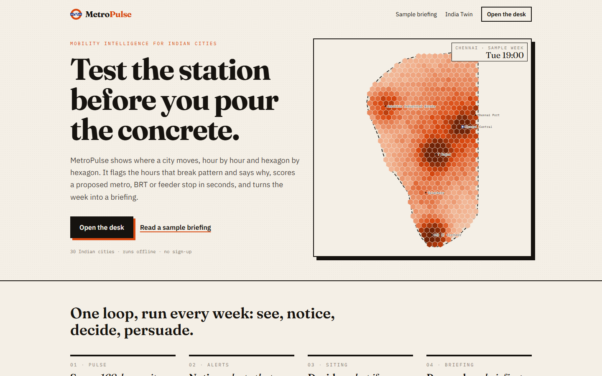
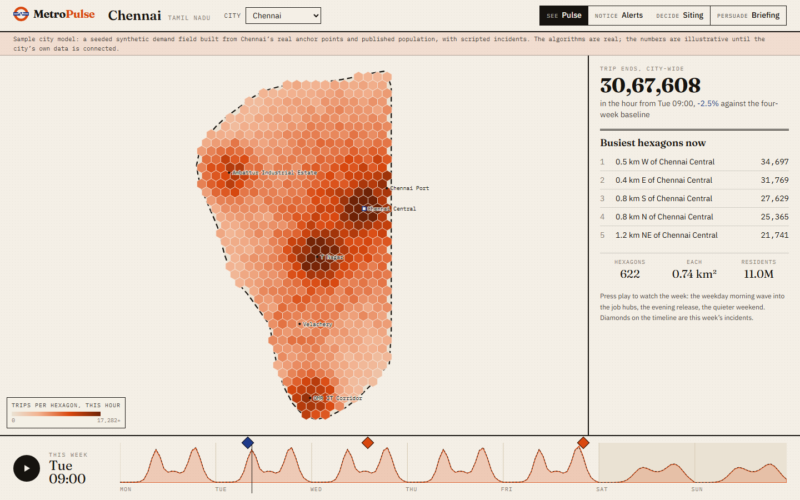
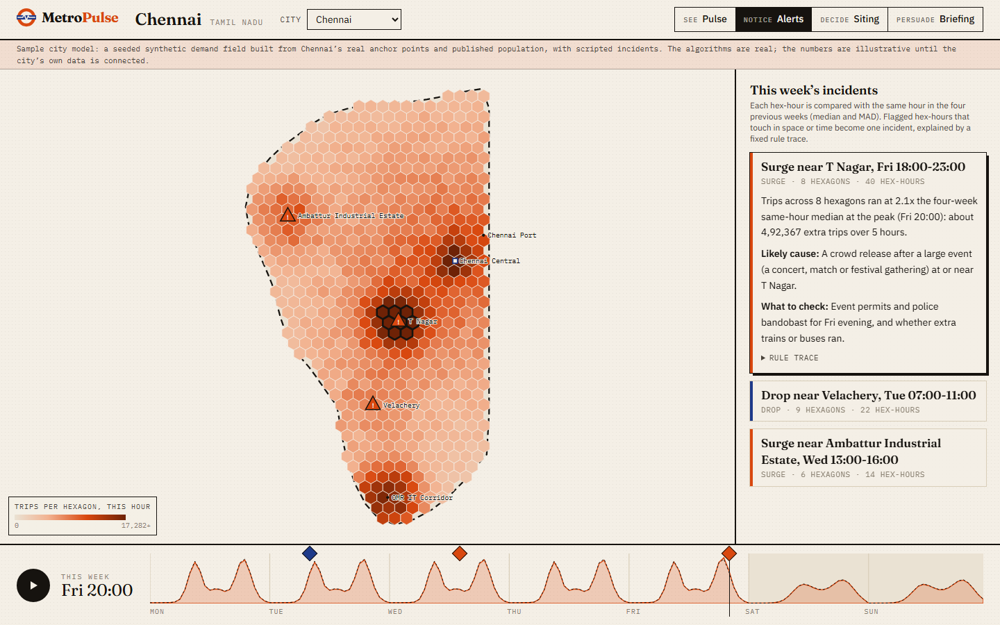
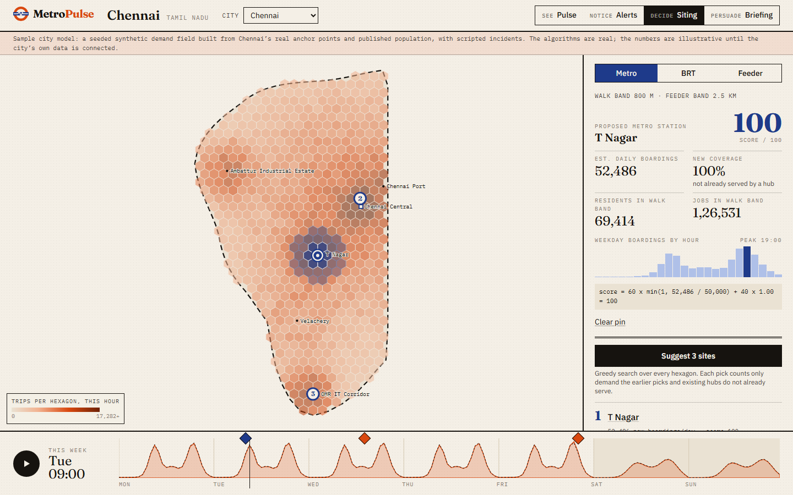
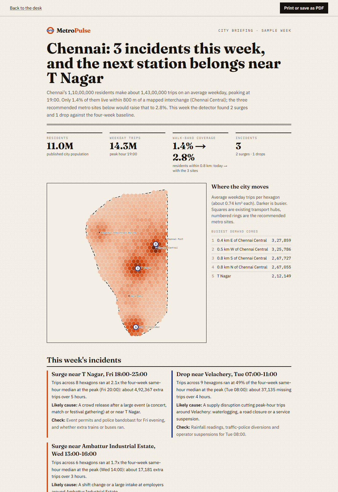
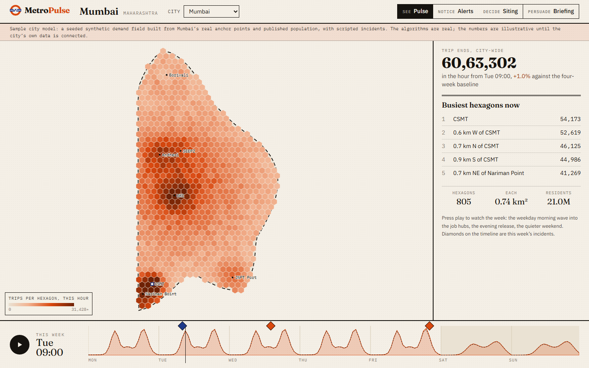
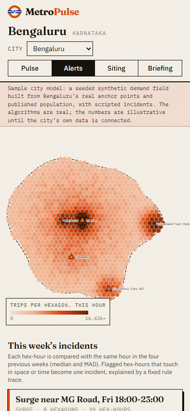
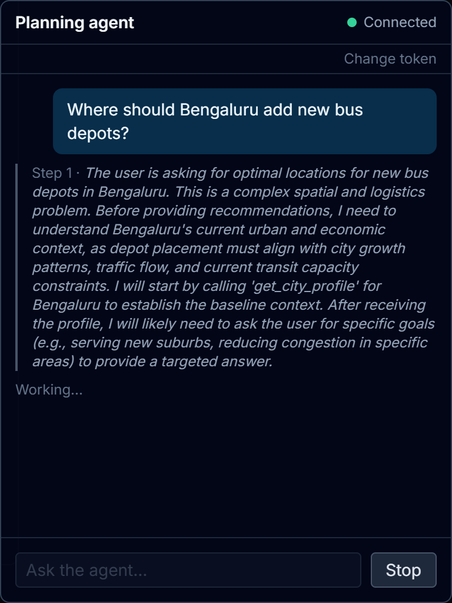
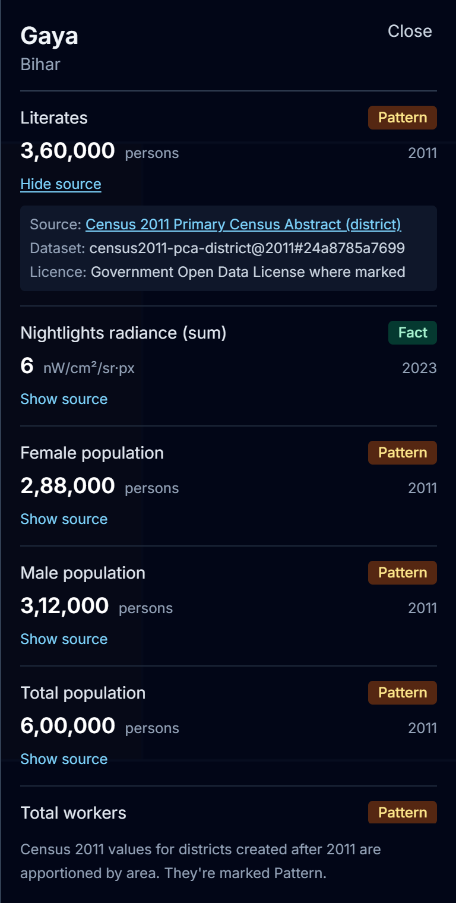

# MetroPulse

### Test the station before you pour the concrete.

MetroPulse is a mobility-intelligence desk for Indian cities. It shows where a city moves, hour by
hour and hexagon by hexagon. It flags the hours that break pattern and says why in plain language.
It scores a proposed metro, BRT or feeder stop in seconds, and it turns the week into a briefing a
commissioner can read on a phone.

It opens on 30 Indian cities, runs entirely in the browser, needs no sign-up, no server and no
language model, and every number on screen shows how it was computed.



> **Honest about data.** The desk runs on the **MetroPulse sample city model**: a seeded, synthetic
> demand field built from each city's real anchor points (CBDs, job hubs, transport hubs,
> residential centres in `data/cities/*.yaml`) and its published population, inside a sample city
> outline. The sample week contains scripted incidents so the detector has something to find. Every
> screen and every briefing says so. **The algorithms are real; the numbers are illustrative until a
> city's own data is connected.**

---

## One loop, run every week: see, notice, decide, persuade

### 1. See: Pulse, a 168-hour city playback

Every hexagon (about 0.74 km², the size of an H3 resolution-8 cell) has a weekday and a weekend
demand profile. Press play to watch the week: the morning wave into the job hubs, the evening
release, the quiet Sunday. The timeline compares this week with the four-week baseline and pins
this week's incidents.



### 2. Notice: alerts that explain themselves

A robust detector compares each hex-hour with the same hour in the four previous weeks (median and
MAD), flags hex-hours at robust z ≥ 4 and a change of at least 30%, and joins flagged hex-hours that
touch in space or time into one incident. Each incident is written up in sentences: what happened,
where, how big, the likely cause and what to check, with the full rule trace one click away.



### 3. Decide: "what if a station opens here?"

Drop a pin and choose metro, BRT or feeder. MetroPulse draws the walk and feeder catchments and
reports residents and jobs in the walk band, estimated daily boardings, how much of that is new
coverage rather than cannibalised from existing hubs, the weekday peak hour, and a 0-100 score with
its formula. Catchments are area-weighted, so the score does not jump with where inside a hexagon
the pin lands. **Suggest 3 sites** runs a greedy search over every hexagon; each pick counts only
the demand the earlier picks and existing hubs do not already serve. Click a suggestion to pin it.



### 4. Persuade: a briefing a commissioner reads on a phone

One click turns the week into an editorial, print-ready briefing: headline numbers, the busiest
demand cores, walk-band coverage today and with the recommended sites, the week's incidents and
the three recommended sites, with methodology and the data caveat at the end. **Print or save as
PDF** produces a clean board-pack page.



### Share exactly what you see

The address bar always holds the current view, so copying it shares that view:

| Link | Opens |
|---|---|
| `/desk?city=pune` | Pune on Pulse |
| `/desk?city=chennai&tab=alerts&incident=1` | Chennai's most severe incident, selected, with the timeline at its peak |
| `/desk?city=chennai&tab=siting&suggest=1` | The three suggested metro sites, the best one pinned and scored |
| `/brief?city=mumbai` | Mumbai's briefing |

<p>


</p>

---

## Try it in two minutes

The desk is frontend-only. No backend, database or API key is needed.

```bash
cd frontend
npm install
npm run dev            # http://localhost:3000
```

Open `/` for the landing page, `/desk` for the desk and `/brief?city=<id>` for a briefing. A
five-minute walkthrough for a live demo is in [`docs/DEMO.md`](docs/DEMO.md). The product brief
(positioning, customers, pricing, roadmap) is in [`docs/PRODUCT.md`](docs/PRODUCT.md).

## How it works

```text
data/cities/*.yaml ──scripts/export_sample_cities.py──▶ frontend/src/data/cities.json
                                                          (30 cities: centre, population,
                                                           anchors, sample outline)
frontend/src/lib/pulse/
  geo.ts      hexagon grid over the outline (pointy-top, H3-res-8 sized), neighbours, radius search
  model.ts    seeded demand field: residents, jobs, leisure and hub profiles by hour of week;
              4 baseline weeks + this week with scripted incidents (deterministic per city)
  alerts.ts   median/MAD baseline per hex-hour → robust-z flags → union-find clusters in space
              and time → rule-traced explanations
  siting.ts   area-weighted walk/feeder catchments, capture rates per mode, cannibalisation
              against existing hubs, score formula, greedy multi-site suggestion, coverage
frontend/src/components/
  desk/       DeskApp (tabs, URL state), HexMap (SVG), Timeline, AlertFeed, SitingPanel
  brief/      Briefing (print stylesheet)
```

| Engine | Rule |
|---|---|
| Baseline | median of the same hour in 4 trailing weeks; spread = 1.4826 × MAD, floored at 8% of the median and 3 trips |
| Flag | robust z ≥ 4 **and** change ≥ 30% of the median |
| Incident | ≥ 3 flagged hex-hours of one sign joined by hexagon adjacency (same hour) or the next hour (same hexagon) |
| Cause | fixed rules on direction, hour and the nearest anchor's type (event, shift change, diverted riders, supply disruption, holiday) |
| Siting score | 60 × min(1, boardings ÷ reference) + 40 × new-coverage share; metro walk 800 m / feeder 2.5 km, BRT 500 m / 1.5 km, feeder bus 400 m / 800 m |

Every engine has unit tests (`frontend/src/lib/pulse/*.test.ts`): every scripted incident is found
in all 30 cities with at most two false alarms, a quiet week raises nothing, the siting score is
stable across a hexagon, a 5 km catchment measures π·25 km² within 10%, and suggestions spread out.

---

## The platform underneath: India Twin and planning agent

The repo also holds the FastAPI backend that the desk will use for real data. It has two parts that
work today:

1. **India Twin** (`/twin`). District boundaries keyed to official LGD codes. It answers place-name
   lookups and serves district indicators from Census 2011 and VIIRS night lights. Every value
   comes with a provenance receipt (source, licence, dataset version, period) and a trust label.
2. **Planning agent.** A ReAct-style agent you chat with over a token-gated WebSocket
   (`/ws/agent`). It streams its reasoning steps, tool calls and clarifying questions.

It produces data-informed estimates for exploration. It does not forecast city outcomes, and its
answers are not decision-grade policy advice. (An older "3-loop" city simulator that streamed hex
frames over `/ws/simulate` was retired in commit `87e958a`.)

| Agent: reasoning step | District panel with provenance receipts |
|---|---|
|  |  |

These two shots are from 2026-10-31: the agent against a local Ollama model with no mocks, and the
district panel built from the synthetic test fixtures in `backend/tests/fixtures/twin/` (the real
build needs 7 source files, some behind a login; see [Data](#data)).

### What exists, in numbers

| | |
|---|---|
| REST endpoints | 16 under `/api/*`, plus one WebSocket, `/ws/agent` (listed [below](#api-reference)) |
| Twin indicators | 6: total, male and female population, literates and workers (Census 2011), and night-light radiance sum (VIIRS) |
| Agent tools | 5: `parse_scenario`, `query_case_studies`, `get_city_profile`, `list_cities`, `compare_sectors` |
| City configs | 30 Indian cities in `data/cities/*.yaml`, exported for the desk to `frontend/src/data/cities.json` |
| Case studies (RAG) | 20, served by `GET /api/case-studies` |
| Realtime connectors | 6: Google News RSS, GDELT, 3 news-sentiment proxies (mobility, jobs, land value), static census |
| LLM providers | MiMo (default), Gemini, OpenAI, Ollama. Set with `LLM_PROVIDER` |
| Backend tests | 870 pytest tests (unit and integration), all passing on 2026-11-02, no network access |
| Frontend tests | 149 Jest + Testing Library tests: the desk engines (projection, model, detector, siting), desk, map, timeline and briefing components, landing page, and the agent chat client |
| API latency | p50 0.8 to 2.6 ms, p99 at most 4.1 ms at concurrency 1, loopback, 1 worker. See [`docs/benchmarks.md`](docs/benchmarks.md) |

---

## Platform architecture

```text
 Next.js 14 (App Router)                          FastAPI
 ┌───────────────────────────────┐   REST    ┌──────────────────────────────────────────┐
 │ IndiaMap  (deck.gl GeoJson)   │ ────────▶ │ /api/twin/*   places, boundaries,        │
 │ PlaceSearch / PlaceCard       │           │               observations, indicators   │
 │ TwinNotBuilt (setup steps)    │           │    └─ Parquet store, atomic publishes,   │
 │ zustand twinStore             │           │       LGD resolver, Census/VIIRS, H3 link│
 │                               │           │ /api/regions, /case-studies, /ingest ... │
 │ AgentChat  (Ask the agent)    │  WS       │ /ws/agent  token-gated, connection limit │
 │   lib/agentChat (reducer,     │ ◀───────▶ │    └─ UrbanAgent (ReAct) + 5 tools       │
 │   parser, 1013 retry/backoff) │           │       NL engine: regex → spaCy router    │
 └───────────────────────────────┘           │       LLM: MiMo / Gemini / OpenAI / Ollama│
                                             │ Supabase Postgres + pgvector, or an       │
                                             │ in-memory fallback when unset             │
                                             └──────────────────────────────────────────┘
```

Some design decisions:

- **A missing value is `null`, never 0.** Districts with no Census link return `value: null`. The
  receipt still names the source, and the build's `report.json` lists those districts under
  `districts_without_value`.
- **Trust labels.** A value measured directly for that district is a `Fact`. A value apportioned
  by area from a parent 2011 district, because the district was created after 2011, is a `Pattern`.
- **Atomic publishes.** A build writes versioned Parquet and then flips `CURRENT.json`. The API
  serves from one consistent version.
- **The agent socket is closed by default.** `AGENT_WS_TOKEN` is checked in constant time and a bad
  token gets close code 1008 before accept. Clients over `WS_MAX_CONNECTIONS` get 1013. The UI
  retries a 1013 with backoff (1, 2, then 4 s, at most 3 retries). Error frames carry no exception
  text.

More detail: [`docs/twin/`](docs/twin), [`docs/RAG_ENGINE.md`](docs/RAG_ENGINE.md) (parked module),
[`docs/DATA_CREDIBILITY.md`](docs/DATA_CREDIBILITY.md), [`docs/LIMITATIONS.md`](docs/LIMITATIONS.md).
[`docs/ARCHITECTURE.md`](docs/ARCHITECTURE.md) covers components, data flow, the agent pipeline,
storage, external services and known limits, with mermaid diagrams.

---

## Full stack: getting started

Prerequisites: Python 3.11+, Node 18+. Supabase and an LLM key are optional.

```bash
# Backend
cd backend
python -m venv .venv
.venv\Scripts\activate            # Windows  (source .venv/bin/activate on Linux/macOS)
python -m pip install -r requirements.txt
python -m spacy download en_core_web_sm
cp .env.example .env              # fill in what you have; empty Supabase = in-memory fallback
python -m uvicorn app.main:app --reload --port 8000

# Frontend
cd frontend
npm install
npm run dev                       # http://localhost:3000
```

If the frontend runs on a port other than 3000, set `CORS_ORIGINS` on the backend. Otherwise every
fetch fails with "Failed to fetch". [`SETUP.md`](SETUP.md) has more troubleshooting.

### Data

The twin needs 7 source files in `data/twin/manual/`. LGD, Survey of India and VIIRS need a
browser login or a captcha, so these files are not downloaded automatically.
[`data/twin/manual/README.md`](data/twin/manual/README.md) lists each one. Then run:

```bash
cd backend
python scripts/twin_build.py check
python scripts/twin_build.py build --boundary-version lgd-YYYYMMDD
```

To see the UI without the real data, build the test fixtures into a scratch folder and point the
API at it with `TWIN_DATA_DIR=<folder>`. The district-panel screenshot was made this way.

### Agent

Set `AGENT_WS_TOKEN` in `backend/.env` and an LLM provider. For a fully local setup, use
`LLM_PROVIDER=ollama` with `LLM_TIMEOUT_MS=150000`, because small local models are slow. In the
UI, click **Ask the agent** and enter the token. The token is kept in `sessionStorage` and never
in a `NEXT_PUBLIC_*` variable.

---

## API reference

All REST responses except GeoJSON boundaries use the envelope `{ "success", "data", "error", "meta" }`.

| Method | Endpoint | Description |
|---|---|---|
| GET | `/api/health` | Health and DB mode (`connected` / `in_memory_fallback`) |
| GET | `/api/health/data` | Data-source freshness for a city |
| GET | `/api/twin/places/resolve?q=&level=&state=` | Name → place id(s), with an ambiguity flag |
| GET | `/api/twin/places/{place_id}` | Place detail: id, name, level, parent and state |
| GET | `/api/twin/places/{place_id}/observations` | Indicator values, each with a receipt and trust label |
| GET | `/api/twin/boundaries/{level}` | GeoJSON boundaries (`country`, `state` or `district`), cached for one day. Plain GeoJSON, not the envelope |
| GET | `/api/twin/indicators` | Indicator catalogue |
| GET | `/api/regions` | 30 city configs |
| GET | `/api/regions/{id}/baseline` | City baseline values |
| GET | `/api/regions/{id}/profile` | City profile |
| GET | `/api/case-studies` | RAG case studies (filter by city, sector, policy) |
| GET | `/api/data-sources` | Registered data sources |
| GET | `/api/snapshots/latest` | Latest realtime snapshot |
| GET | `/api/snapshots/{id}/quality` | Snapshot quality report |
| POST | `/api/ingest` | Trigger realtime ingestion. Open unless `INGEST_TOKEN` is set (then `Authorization: Bearer <token>` or `X-Ingest-Token`, else 401) |
| GET | `/api/agent/status` | `{enabled, available, path}`. Never returns the token |
| WS | `/ws/agent` | Agent chat stream. Disabled unless `AGENT_WS_TOKEN` is set |

If the twin data has not been built, `/api/twin/*` returns a 503 that says how to build it.

## WebSocket protocol

Connect with the token as `?token=` or `Authorization: Bearer <token>`:

```text
ws://localhost:8000/ws/agent?token=<AGENT_WS_TOKEN>
```

A missing or wrong token gets close code 1008 before accept. A browser sees this as close code 1006.
More than `WS_MAX_CONNECTIONS` (default 10) concurrent sessions get 1013.

Send `{ "type": "AGENT_START", "message": "What happens to Pune if IT FDI rises 30%?" }`, then
receive these as the agent works:

```text
AGENT_START   session id
AGENT_THINK   reasoning step
AGENT_ACTION  tool call the agent is making
AGENT_ASK     clarifying question with options -> answer with { "type": "AGENT_REPLY", "message": "..." }
AGENT_RESULT  final answer
AGENT_DONE    session finished (server then closes with 1000)
AGENT_ERROR   generic error text (no exception details)
```

`{ "type": "PING" }` is answered with `{ "type": "PONG" }`. Messages are capped at 4000 characters.

---

## Testing

```bash
cd backend
python -m pytest tests -q          # unit + integration

cd frontend
npm run test                       # jest (npm run test:ci in CI; locally `npx jest --maxWorkers=2`)
npm run lint
npm run type-check
npm run build
```

The backend suite is hermetic: `tests/conftest.py` ignores the Supabase and LLM settings in
`backend/.env` and fails any test that opens a non-loopback connection. Mock HTTP with
`httpx.MockTransport`; mark a deliberate live test with `@pytest.mark.allow_network`.
The frontend has the same rule: `jest.setup.js` replaces `fetch`, `WebSocket` and `XMLHttpRequest`
with stand-ins that fail the test unless the test installs its own mock.

`scripts/bench_api.py` benchmarks a running backend and writes `docs/benchmarks.md`. Start that
backend with `RATE_LIMIT_PER_MINUTE=0`: the default limit of 240 requests per minute per IP is far
below a benchmark's request rate, and the script stops with exit status 2 on the first 429.
`backend/tests/load/locustfile.py` load-tests `/ws/agent` (PING/PONG, no LLM calls): set
`AGENT_WS_TOKEN` and run `locust -f tests/load/locustfile.py --host=http://localhost:8000` from `backend/`.
CI (`.github/workflows/ci.yml`) runs the backend tests, then lint, type-check and Jest on the frontend.

## Project structure

```text
backend/
  app/
    routes/        health, regions, case_studies, realtime, twin
    ws/agent.py    /ws/agent (auth, connection limit, streaming)
    rag/           retriever, evidence pack, coefficient extractor (not wired into the running app)
    simulation/    llm.py (provider switch, used by the agent); confidence, overlay and
                   explainability are leftovers from the retired simulator
    realtime.py    6 ingestion connectors
  engine/
    agent/         UrbanAgent, tools, prompts, memory
    nl_engine/     regex + spaCy intent router, conversation state
  twin/
    places/        LGD loading, name resolver, boundaries, crosswalk, H3 link
    pipeline/      census2011, viirs
    store/         Parquet store, catalog, atomic publish, optional Postgres sync
  scripts/twin_build.py
  tests/           unit/, integration/, fixtures/twin/
frontend/src/
  app/             page.tsx (landing), desk/, brief/, twin/ (India Twin map)
  lib/pulse/       sample city model, incident detector, station siting (see How it works)
  components/desk/ DeskApp, HexMap, Timeline, AlertFeed, SitingPanel
  components/brief/Briefing.tsx
  components/twin/ IndiaMap, PlaceSearch, PlaceCard, TwinNotBuilt
  components/agent/AgentChat.tsx
  lib/             agentChat.ts (protocol), twinApi.ts
  store/twinStore.ts
data/              cities/, sez/, transit/, slums/, flood/, twin/{manual,seed}
scripts/           export_sample_cities.py (city configs -> desk JSON)
docs/              twin/, benchmarks.md, LIMITATIONS.md, ...
```

## Known gaps

- The desk runs on the sample city model. Connectors for a city's own data (GTFS stations,
  survey zones, AFC taps) are the next step; until then its numbers are illustrative.
- The sample outlines are drawn around each city's anchors, not administrative boundaries, and
  each city has one mapped interchange, so "existing coverage" is a lower bound.
- Every sample week carries the same three kinds of scripted incident.

- `/ws/agent` uses one shared token. Per-user auth is planned (spec §4).
- No real-data twin build has been published yet. See [Data](#data).
- `POST /api/ingest` is open by default: anyone who can reach the API can trigger outbound news
  fetches. Set `INGEST_TOKEN` in `backend/.env` to require a token (off by default so nothing
  changes for existing setups).
- The agent's ReAct prompt grows with each step and is resent in full. On slow local models, no
  run has reached `AGENT_RESULT` yet.
- The modelling limitations are listed in [`docs/LIMITATIONS.md`](docs/LIMITATIONS.md).
- There is no `LICENSE` file yet.
