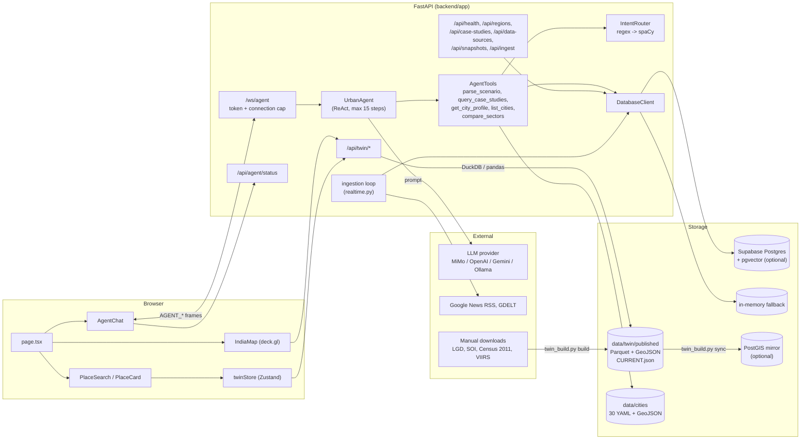
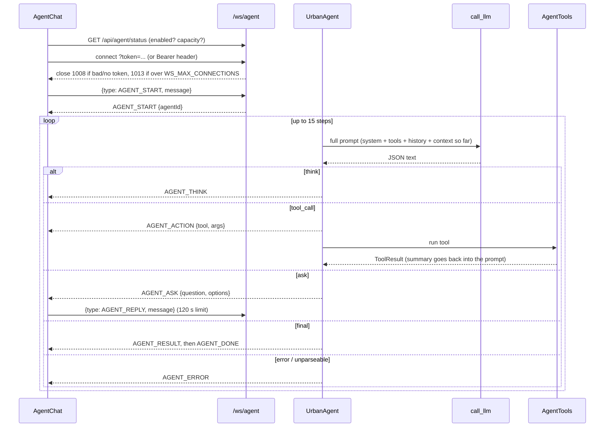

# MetroPulse Architecture

This document describes the code as it is on the `night-run` branches (checked 2026-11-02),
not the original plan. MetroPulse has two user-facing parts:

1. **India Twin**: a map of India's states and districts. Clicking or searching a place shows
   its indicators (Census 2011 population figures, VIIRS night lights), each with a source
   receipt (source, dataset version, licence, URL).
2. **Urban agent**: a ReAct-style LLM agent, reached over the `/ws/agent` WebSocket. It answers
   urban-policy questions about 30 Indian cities using 5 read-only tools.

The earlier month-by-month simulator (primary/secondary/tertiary loops, `/ws/simulate`,
simulation frames) has been retired and its modules were removed from the tree in 2.0.0.

## Components

| Layer | Technology | Where |
|-------|------------|-------|
| Frontend | Next.js 14 (App Router), React 18, TypeScript, Zustand 4, Tailwind 3, deck.gl 9 (`GeoJsonLayer`) | `frontend/src` |
| API | FastAPI with uvicorn, Python 3.11+ | `backend/app` |
| Agent | `UrbanAgent` ReAct loop, `AgentTools`, `AgentMemory` | `backend/engine/agent` |
| Scenario parsing | `IntentRouter`: regex parser, then spaCy `en_core_web_sm` if confidence is low | `backend/engine/nl_engine` |
| Twin build | Pipeline adapters (pandas, geopandas, shapely, rasterio, h3) | `backend/twin`, `backend/scripts/twin_build.py` |
| Twin store | Versioned Parquet files read with DuckDB, `CURRENT.json` pointer | `data/twin/published` |
| App DB (optional) | Supabase Postgres + pgvector; in-memory fallback when unset | `backend/app/db.py`, `supabase/migrations` |
| Twin DB mirror (optional) | Postgres/PostGIS via psycopg2 | `backend/twin/store/pg_sync.py` |
| LLM | One of `mimo` (default), `openai`, `gemini`, `ollama` | `backend/app/llm.py` |

### Backend modules in use

These are the modules loaded by `app.main` plus the agent's lazily loaded spaCy parser.
The list was produced by importing `app.main` and listing `sys.modules`.

```
backend/
├── app/
│   ├── main.py            FastAPI app, CORS, routers, lifespan (DB connect, ingestion loop)
│   ├── config.py          Settings from env / backend/.env (pydantic-settings)
│   ├── db.py              DatabaseClient: Supabase or in-memory; 20 built-in case studies,
│   │                      case-study ranking, embeddings for pgvector search
│   ├── data_registry.py   SOURCE_REGISTRY: 23 source definitions (licence, URL, cadence),
│   │                      used for twin receipts and /api/data-sources
│   ├── realtime.py        6 connectors (Google News RSS, GDELT, 3 news-sentiment proxies,
│   │                      static census from city YAML) and run_ingestion_cycle()
│   ├── realtime_models.py SnapshotData, SourceStatus, SnapshotQuality
│   ├── llm.py             call_llm: provider dispatch for the agent
│   ├── routes/            health, regions, case_studies, realtime, twin
│   └── ws/agent.py        /ws/agent socket and GET /api/agent/status
├── engine/
│   ├── agent/             UrbanAgent, AgentTools, AgentMemory, prompts
│   ├── nl_engine/         IntentRouter, RegexParser, SpacyParser, domain_maps
│   │                      (used only by the agent's parse_scenario tool)
│   ├── config.py          CityConfig: loads data/cities/<city>.yaml (30 cities)
│   └── models.py          ParsedScenario, sector names and labels
└── twin/
    ├── paths.py           TwinPaths: manual/, raw/, seed/, published/ layout
    ├── places/            LGD loader, boundaries, Census 2011 crosswalk, H3 link,
    │                      name normalisation, PlaceResolver (rapidfuzz)
    ├── pipeline/          run_pipeline() + adapters: census2011, viirs
    └── store/             parquet_store, catalog, atomic publish, schema, pg_sync
```

`twin/pipeline/census2011.py`, `twin/pipeline/viirs.py` and `twin/store/pg_sync.py` are used,
but only by the build CLI.

### Frontend

```
frontend/src/
├── app/page.tsx                     Landing page (computed from the sample model at build time)
├── app/desk, brief, compare         The desk (Pulse, Alerts, Siting with Stop/Line), briefing, compare
├── app/city/[id]                    30 static city pages + on-request Open Graph image
├── app/api/v1/*                     JSON API route handlers (envelope in lib/api/envelope.ts)
├── app/developers, privacy          API docs, privacy statement
├── lib/pulse/*                      Browser engines: model, alerts, siting, scenario, calibrate,
│                                    summary, alternatives, import/ parsers, userdata and
│                                    scenarioStore (localStorage with in-memory fallback)
├── components/desk/*                DeskApp, HexMap, Timeline, AlertFeed, SitingPanel, LinePanel,
│                                    DataDrawer, useLineScenario
├── app/twin/page.tsx                India Twin map page: map, search, place panel, agent chat
├── components/twin/IndiaMap.tsx     deck.gl GeoJsonLayer over /api/twin/boundaries/{level}
├── components/twin/PlaceSearch.tsx  /api/twin/places/resolve
├── components/twin/PlaceCard.tsx    Indicators with receipts for the selected place
├── components/twin/TwinNotBuilt.tsx Setup steps shown when the API returns 503
├── components/agent/AgentChat.tsx   /ws/agent client UI (status pill, steps, ask/reply)
├── lib/twinApi.ts                   REST client for /api/twin/*
├── lib/agentChat.ts                 Chat reducer, frame parser, URL and retry logic
└── store/twinStore.ts               Zustand store: selected place, observations, errors
```

The map component is loaded with `next/dynamic` (`ssr: false`), so deck.gl never runs on the
server. The agent token is typed into the chat panel and kept in `sessionStorage`. It is never
a `NEXT_PUBLIC_*` variable.

## Diagram



## Data flow

### India Twin (read path)

1. `IndiaMap` fetches `GET /api/twin/boundaries/{country|state|district}`. The response is a
   simplified GeoJSON file served as is, with a one-day cache header.
2. A click or a search result calls `twinStore.selectPlace(id)`. The store calls
   `GET /api/twin/places/{id}/observations`, and `page.tsx` calls `GET /api/twin/places/{id}`
   for the name and parent state. Responses that arrive after the selection has changed are
   dropped.
3. On the server, `get_twin_context()` loads the place backbone, the aliases and the indicator
   catalogue once. The cache key is the data directory plus the `CURRENT.json` mtime, so
   publishing a new build is picked up without a restart.
4. Observations come from `query_observations()`. It runs DuckDB `read_parquet` over the
   datasets that `CURRENT.json` points at. For each indicator the newest period is returned,
   with a receipt from `SOURCE_REGISTRY`.
5. If `CURRENT.json` is missing, every `/api/twin/*` route returns 503 with build
   instructions, and the UI shows `TwinNotBuilt`.

All twin JSON responses use the `{success, data, error, meta}` envelope. Boundaries are the
one deliberate exception.

### India Twin (build path)

`python scripts/twin_build.py check | build --boundary-version lgd-YYYYMMDD | sync` (run from
`backend/`):

1. `check` lists the 7 manual files expected under `data/twin/manual/`: LGD states and
   districts, SOI district boundaries and India outline, Census 2011 district boundaries,
   Census 2011 PCA, and a VIIRS annual GeoTIFF.
2. `build_backbone()` joins LGD codes to SOI geometry and builds a Census 2011 to current
   district crosswalk (area-weighted). It also writes the H3 r5/r7 link and simplified
   boundaries per level. It fails if any boundary is unmatched or any district has no
   boundary.
3. `run_pipeline()` runs each adapter (`Census2011Adapter`, `ViirsAdapter`). The steps are:
   hash the inputs, copy the raw files, transform, validate against the observation schema
   (`indicator, place_id, period, value, unit, source_id, dataset_version, trust_label`), then
   write Parquet through `publish_dir()`. That function writes to a temp sibling and swaps it in
   with renames.
4. Only after every gate and adapter passes does `set_current_many()` switch `places` and every
   dataset version in `CURRENT.json`, in one atomic write.
5. `sync` (optional, needs `TWIN_PG_DSN` or `--dsn`) upserts places, indicators and dataset
   versions into Postgres/PostGIS (`supabase/migrations/008`, `009`).

## Agent pipeline



Details that matter when changing it:

- **Guards** (`app/ws/agent.py`): the socket is disabled unless `AGENT_WS_TOKEN` is set. The
  token is compared with `hmac.compare_digest`, and rejection happens before `accept()`. A
  module-level `ConnectionLimiter` enforces `WS_MAX_CONNECTIONS` and always releases its slot.
  Client messages are clipped to 4000 characters and must be at least 4. The first
  `AGENT_START` must arrive within 30 s. `PING` gets `PONG` at any time. Exception text is only
  logged; the client gets a generic `AGENT_ERROR`.
- **Prompting** (`engine/agent/agent.py`): the agent builds one prompt string (ReAct system
  prompt, tool descriptions, memory history) and then appends each step's thought or tool
  result to it. Every LLM call gets the whole string, so prompt size grows with the step count.
- **Parsing**: the reply is read as JSON. The parser strips a ```` ```json ```` fence and
  then takes the text from the first `{` to the last `}`. Unparseable output ends the run with
  an `AGENT_ERROR`. An unknown `type` adds a correction note to the prompt and continues.
- **Tools** (`engine/agent/tools.py`): all 5 are read-only. Arguments from the LLM are passed
  as `**kwargs`. A wrong argument name raises, which becomes a failed `ToolResult` that is fed
  back to the model rather than crashing the session.
  - `parse_scenario`: `IntentRouter` uses regex first (accepted at confidence 0.8 or higher),
    then spaCy (0.6 or higher), else the better of the two.
  - `query_case_studies`: with Supabase, an embedding plus the pgvector `match_case_studies`
    RPC; otherwise keyword ranking over the 20 built-in case studies.
  - `get_city_profile`, `compare_sectors`, `list_cities`: read `data/cities/*.yaml`.
- **LLM call** (`app/llm.py`): `LLM_PROVIDER` picks the backend. Each call has an
  `LLM_TIMEOUT_MS` limit (default 25 s). OpenAI uses JSON mode. MiMo gets a "JSON only"
  system message. Ollama uses `/api/chat` with `stream: false` and sends `options.num_ctx` from
  `OLLAMA_NUM_CTX` (default 8192; 0 leaves the server default, which can be very large).
- **Memory**: `AgentMemory` keeps at most 40 entries and formats about 2000 tokens (8000
  characters) of history. A new `UrbanAgent` is created for each connection, so nothing
  persists between sessions.

## Storage

| Store | Contents | Required? |
|-------|----------|-----------|
| `data/twin/published/` | `places/<boundary_version>/` (backbone, aliases, boundaries GeoJSON, H3 link), `datasets/<source>/<version>/observations.parquet` + `report.json`, `catalog/indicators.parquet`, `CURRENT.json` | Needed for the twin; not in git, produced by `twin_build.py build` |
| `data/twin/manual/`, `raw/` | Hand-downloaded inputs and hashed raw copies | Build input only |
| `data/twin/seed/aliases.csv` | Place-name aliases | Committed |
| `data/cities/*.yaml` + `.geojson` | 30 city configs (sector weights, baselines, zones) | Committed |
| Supabase (`supabase/migrations/001`-`009`) | Case studies with pgvector embeddings, data sources, raw observations, city snapshots, simulations, dataset versions, twin places | Optional. Without `SUPABASE_URL`/`SUPABASE_KEY`, `DatabaseClient` keeps everything in process memory and `/api/health` reports `in_memory_fallback` |
| PostGIS mirror | Copy of the twin backbone and catalogue | Optional (`twin_build.py sync`) |

## External services

| Service | Used by | When |
|---------|---------|------|
| LLM API (MiMo gateway, OpenAI, Gemini, or local Ollama) | `call_llm` | Every agent step |
| Embedding API (same providers) | `db.generate_embedding` | Case-study search and seeding, only with Supabase |
| Supabase | `DatabaseClient` | When configured |
| Google News RSS, GDELT | `realtime.py` connectors | At startup for each city (2 s apart), then one city every `NEWS_REFRESH_SECONDS` (900 s), and on `POST /api/ingest` |
| LGD, Survey of India, Census, VIIRS (EOG) | People, by hand | Twin build inputs; LGD, SOI and VIIRS need a browser login or captcha |

## Configuration

Read by `app/config.py` from the environment or `backend/.env`. The settings that change
behaviour most are `AGENT_WS_TOKEN`, `INGEST_TOKEN`, `WS_MAX_CONNECTIONS`, `LLM_PROVIDER`, `LLM_MODEL`,
`LLM_TIMEOUT_MS`, the provider keys, `SUPABASE_URL`/`SUPABASE_KEY`, `CORS_ORIGINS`,
`TWIN_DATA_DIR`, `NEWS_REFRESH_SECONDS` and `SEED_CASE_STUDIES_ON_STARTUP`. The frontend reads
`NEXT_PUBLIC_API_URL` and `NEXT_PUBLIC_WS_URL`.

## Known limits

- **No twin data in a fresh clone.** The build needs 7 manual downloads, and 3 of them need a
  browser login or captcha. Until they are present, the map shows the setup panel.
- **Shared-token auth.** `/ws/agent` uses one shared `AGENT_WS_TOKEN`. There are no per-user
  accounts or quotas. `POST /api/ingest` is open unless `INGEST_TOKEN` is set (opt-in; then it needs
  `Authorization: Bearer <token>` or `X-Ingest-Token` and answers 401 otherwise), so by default
  anyone who can reach the API can trigger outbound fetches.
- **Per-process state.** The connection limiter, the twin context cache and the in-memory DB
  live in one process. Running several uvicorn workers multiplies the connection cap and splits
  the state.
- **Prompt growth.** The agent's prompt grows with every step (up to 15) and is resent in full
  each time. On slow local models, single steps took 25-150 s in testing. No run has reached
  `AGENT_RESULT` locally yet.
- **Brittle output parsing.** One malformed LLM reply ends the session with an error; the agent
  does not retry.
- **No forecasting.** There is no simulation tool. `compare_sectors` multiplies each requested
  sector change by that sector's weight in the city config and ranks the products; it is a
  static estimate, and the tool descriptions sent to the LLM say so. A unit test fails if any
  prompt text (`REACT_SYSTEM_PROMPT`, the tool descriptions, or the exported but unused
  `AGENT_SYSTEM_PROMPT`/`PLAN_PROMPT`/`TOOL_DESCRIPTIONS`) mentions simulation again.
- **Thin indicators.** Only Census 2011 (5 population indicators) and VIIRS night lights have
  adapters. The other entries among the 23 in `SOURCE_REGISTRY` are metadata only.
- **Proxy "realtime" data.** The mobility, jobs and land-value signals come from news keyword
  sentiment, not measurements, and nothing in the current UI shows them.
- **Census 2011 to current districts** is an area-weighted apportionment, so district values for
  districts created after 2011 are estimates.

For data and modelling caveats, see `docs/LIMITATIONS.md` and `docs/DATA_CREDIBILITY.md`.

## The desk's data path (2.0)

Nothing a user loads leaves the browser. `DataDrawer` parses a GeoJSON boundary, a GTFS zip or a
stations CSV, and a counts CSV with the parsers in `lib/pulse/import/`; only the derived
`CityData` (ring, stations, daily counts, zones) is written to `localStorage` under
`metropulse.citydata.<city>.v1`. `getCityModel(city, data)` rebuilds the hexagon grid on the user's
boundary, uses their stations as the existing hubs (each with its own mode's walk band) and, when
counts match three or more stations of a mode, computes a calibration factor that `scoreSite`
applies and prints in its formula. Without data the model is bit-identical to 1.x (pinned in
`model.test.ts`). Lines (`lib/pulse/scenario.ts`) are saved under `metropulse.scenarios.v1` and
encoded into share links as `s=<mode>.<alignment>.<lat,lng;...>`. GTFS zips are parsed in a Web Worker
(`import/gtfs.worker.ts`, inline fallback). The JSON API serves the sample model only; it never sees a
user's data (ADR 0002, 0004). The optional workspace (`lib/cloud/`) syncs saved lines, and only those,
to a Supabase `scenarios` table under row-level security when the public env values are set.
